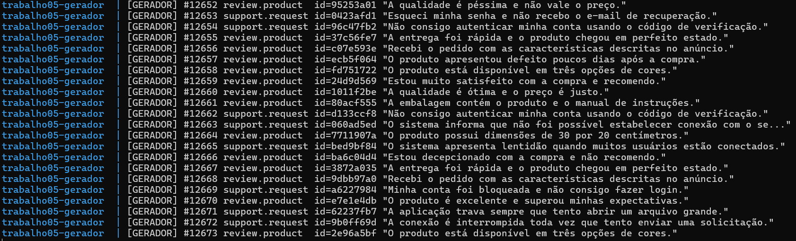
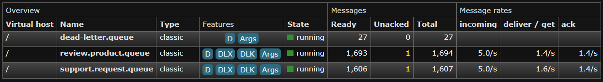
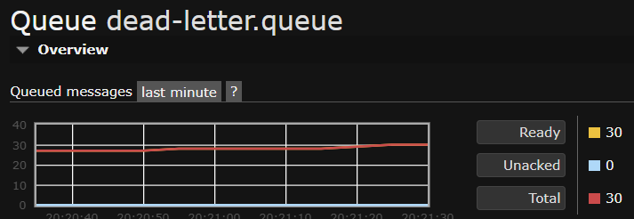
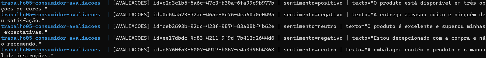
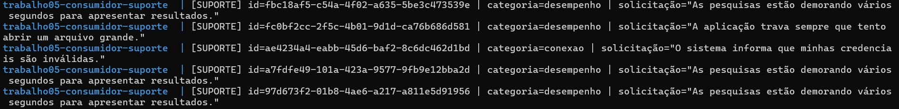
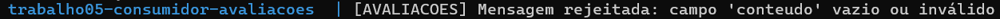
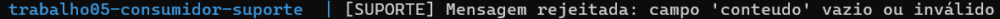

# Trabalho 05 - Sistema distribuído de classificação com RabbitMQ

Sistema distribuído em Java, Docker e RabbitMQ que gera mensagens, roteia cada
tipo por um Topic Exchange e classifica o conteúdo com dois modelos
independentes de Inteligência Artificial. O video de demonstração está disponível no [YouTube](https://youtu.be/HgOmFi7wRLw).

## Arquitetura

O `docker compose` inicia exatamente quatro containers de serviço:

```text
gerador --(messages.topic / topic)--> review.product.queue
                                    --> support.request.queue

review.product.queue  --> consumidor-avaliacoes --> modelo-avaliacoes.bin
support.request.queue --> consumidor-suporte    --> modelo-suporte.bin

filas de origem --(rejeição sem requeue)--> dead-letter.exchange
                                           --> dead-letter.queue
```

- `rabbitmq`: RabbitMQ 4 com painel de administração em
  `http://localhost:15672`;
- `gerador`: publica 10 mensagens por segundo, alternando avaliações de
  produtos e solicitações de suporte;
- `consumidor-avaliacoes`: consome somente `review.product` e classifica como
  `positivo`, `negativo` ou `neutro`;
- `consumidor-suporte`: consome somente `support.request` e classifica como
  `acesso`, `desempenho` ou `conexao`.

Cada mensagem possui `id` (UUID), `timestamp`, `tipo` e `conteudo`. As
mensagens são persistentes e usam as routing keys `review.product` e
`support.request`. Os consumidores usam `basicQos(1)`, confirmação manual
(`basicAck`) e rejeição sem reprocessamento (`basicNack(..., false, false)`).
As filas de origem possuem argumentos de dead lettering, encaminhando mensagens
com erro para `dead-letter.queue`.

O gerador cria uma mensagem inválida (conteúdo vazio) a cada 50 mensagens
(`POISON_EVERY=50`) para tornar a demonstração da DLQ reproduzível. Cada
consumidor aguarda 1,5 segundo antes do ACK (`PROCESSING_DELAY_MS=1500`), de
modo que a taxa de processamento seja menor que a taxa de chegada e o
crescimento das filas possa ser observado no painel.

## Modelos de IA

O módulo `treinamento/` treina dois classificadores Multinomial Naive Bayes da
biblioteca [Smile](https://haifengl.github.io/). Cada texto é convertido em um
vetor de contagem de palavras (bag-of-words):

- `modelo-avaliacoes.bin`: sentimentos `positivo`, `negativo` e `neutro`;
- `modelo-suporte.bin`: categorias `acesso`, `desempenho` e `conexao`.

Os consumidores carregam os artefatos binários e possuem sua própria instância
do mecanismo de classificação.

## Execução

Pré-requisitos: Docker Desktop com Docker Compose, ou Docker Engine com o
plugin `docker compose`.

Para gerar novamente os modelos:

```bash
mvn -f treinamento/pom.xml compile exec:java \
  -Dexec.mainClass=TreinarModeloAvaliacoes
mvn -f treinamento/pom.xml compile exec:java \
  -Dexec.mainClass=TreinarModeloSuporte
```

Para compilar os módulos Java:

```bash
mvn -f gerador/pom.xml package
mvn -f consumidor-avaliacoes/pom.xml package
mvn -f consumidor-suporte/pom.xml package
```

Para iniciar os quatro containers:

```bash
docker compose up --build
```

Para acompanhar os logs:

```bash
docker compose logs -f gerador
docker compose logs -f consumidor-avaliacoes
docker compose logs -f consumidor-suporte
```

No painel do RabbitMQ, use:

- usuário: `luciano`;
- senha: `luciano123`;
- vhost: `/`.

Abra **Queues and Streams** para observar
`review.product.queue`, `support.request.queue` e `dead-letter.queue`.

## Evidências da execução

As capturas abaixo foram feitas durante a execução dos containers. Elas mostram
as classificações, o acúmulo de mensagens nas filas e a configuração e ocupação
da DLQ. Os números podem variar entre capturas porque as filas continuam sendo
atualizadas durante a execução.

### Filas e encaminhamento para a DLQ

O log do gerador mostra publicações contínuas com as routing keys
`review.product` e `support.request`, acompanhadas de identificadores e
conteúdos das mensagens.



A visão geral do RabbitMQ mostra as três filas em estado `running`. Na captura,
`review.product.queue` tem 1.693 mensagens prontas e uma não confirmada; a taxa
de entrada é 5,0 mensagens/s, acima das taxas de entrega e ACK (1,4/s). Já
`support.request.queue` tem 1.606 prontas e uma não confirmada; sua entrada
também é 5,0/s, acima da entrega (1,6/s) e do ACK (1,4/s). Esses valores mostram
o acúmulo de mensagens enquanto a entrada permanece acima do processamento.
As features `DLX` e `DLK` indicam que as filas de origem têm configuração de
dead-letter exchange e dead-letter routing key.



Na captura da visão geral, `dead-letter.queue` tem 27 mensagens prontas e zero
não confirmadas. A captura de detalhes dessa fila, feita em outro momento,
mostra 30 prontas, zero não confirmadas e 30 no total. A diferença de contagem
é esperada entre capturas realizadas em momentos distintos. O gráfico mostra o
histórico de mensagens enfileiradas no último minuto.

Essas telas mostram a quantidade e o estado das mensagens, mas não exibem seu
conteúdo. A confirmação de que uma mensagem específica é inválida depende dos
logs de rejeição dos consumidores e da configuração de dead lettering mostrada
no projeto; para inspecionar o corpo, é necessário consultar as mensagens da
fila na interface do RabbitMQ.



### Classificação das avaliações e solicitações

Os logs mostram o identificador e a classificação calculada pelo consumidor de
avaliações (sentimento) e pelo consumidor de suporte (categoria).





### Rejeição de mensagens inválidas

Os dois consumidores registram a rejeição de mensagens sem conteúdo válido.
Como as filas estão configuradas com dead lettering, essas mensagens são
encaminhadas para `dead-letter.queue` em vez de serem descartadas.





## Vídeo de demonstração

[Assistir à demonstração do sistema no YouTube](https://youtu.be/HgOmFi7wRLw)

